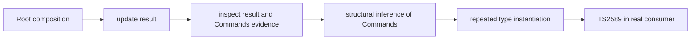

# Foldkit f3be type-checking investigation

**Status: investigation, not a reproduction of TS2589.** A real consumer fails with the published declarations and passes with a declaration-only candidate, but the standalone controls here currently compile with both. Do not report these controls as a failing reproduction.

## Environment

- Foldkit `0.169.0-canary.f3be22cfeefe`, PR [#1655](https://github.com/foldkit/foldkit/pull/1655), commit `f3be22cfeefed437164ad614d08b16d9000e0703`.
- Effect `4.0.0`, Native TypeScript `7.1.0-beta`, Bun `1.3.14`, Linux x64.

Install the unpatched published package and run the current 8-level nested control:

```sh
bun install --frozen-lockfile --ignore-scripts
node node_modules/@typescript/native/bin/tsc -p tsconfig.json --extendedDiagnostics
```

`src.ts` is generated by `python nest.py`: six child Bindings at each level, with concrete model and message contracts and connected operations. It is a control, not a minimal failure. A separate `generate-basic.py` produces a flat Root given binding and handler counts (for example `python generate-basic.py 36 64`); it overwrites `src.ts`.

## Current observations

The 8-level control passed with original declarations in one run (4,216,473 total instantiations; 14.338 s checking), and with the candidate in another (4,125,966; 22.663 s). These are single local measurements, not an editor benchmark or a demonstrated speedup. Raw outputs are in `evidence/`. They do not reproduce the consumer's TS2589.

The candidate at `experiments/candidate.patch` is not applied by installation. In the real consumer an A/B comparison, holding configuration and sources fixed, reproduced TS2589 with the original declarations and compiled with this candidate. That consumer is not included in this independent directory. A different previously reported [#1772](https://github.com/foldkit/foldkit/issues/1772) concerns reciprocal policy resolution in an earlier snapshot; [#1709](https://github.com/foldkit/foldkit/issues/1709) tracks broader inference and editor performance.

## Evidence-contract controls

Run `python scripts/verify-contracts.py` after installation. It copies the installed dependencies into a temporary directory and checks 80 named shapes across four metadata channels plus five semantic assertions. Published declarations and the candidate should pass. An intentionally naive indexed extraction without the index-signature fallback must produce TS2344. The temporary copy is removed; the installed declarations stay unchanged. This checks the sampled contracts, not universal equivalence or the large-graph failure.

## Working hypothesis



The candidate tries indexed extraction for an explicitly declared `commands` property while retaining the old structural inference for index-only shapes. This is an investigation direction, not an upstream-reviewed or universally proven solution. Required checks include Commands and return evidence, Deferred evidence, negative handler/Layer/binding cases, generic and index-signature shapes, and representative emitted-package consumers. A prior pure indexed variant changed the result for a string-index-only type and was rejected.

## Next steps

Reduce the real consumer into independent Blocks while retaining the failing graph and channels. Capture the same workload against original and candidate declarations, and require unpatched TS2589 plus candidate success before claiming reproduction. Validate in a clean installation; add positive and negative contract cases and link related upstream reports before proposing anything.
