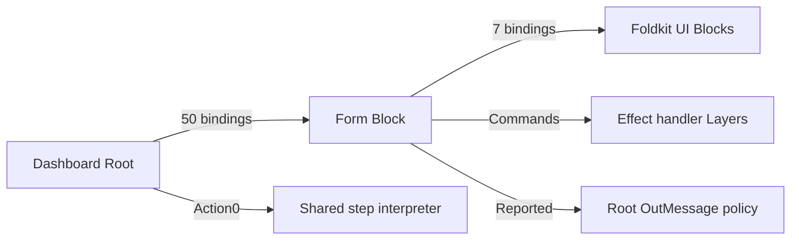
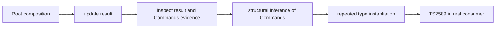

# Foldkit f3be type-checking investigation

**Status: independent TS2589 reproduction.** The same Foldkit + Effect consumer fails at `Root.makeUpdate` with the published declarations and passes with the declaration-only candidate. The graph is synthetic and based on the shape observed in the larger consumer; it is not a minimal case or proof of universal equivalence.

## Run the practical example

```sh
bun install --frozen-lockfile --ignore-scripts
bun run dev
```

Open `http://127.0.0.1:5346/`. The two counters are separate instances of one Counter Block. Try adding to each column, then to both. The board wires them through bindings and uses `Update.combineSteps` for the combined action. Read [`example/board.ts`](example/board.ts) for the composition and [`example/main.ts`](example/main.ts) for the browser adapter. `bun run typecheck:example` checks that code against the published preview.

**This small browser example is a passing control.** The separate large-graph reproduction below demonstrates TS2589.

## Environment

- Foldkit `0.169.0-canary.f3be22cfeefe`, PR [#1655](https://github.com/foldkit/foldkit/pull/1655), commit `f3be22cfeefed437164ad614d08b16d9000e0703`.
- Effect `4.0.0`, Native TypeScript `7.1.0-beta`, Bun `1.3.14`, Linux x64.

Install the unpatched published package and run the current 8-level nested control:

```sh
bun install --frozen-lockfile --ignore-scripts
node node_modules/@typescript/native/bin/tsc -p tsconfig.json --extendedDiagnostics
```

`stress/generated.ts` is generated by `python nest.py`: six child Bindings at each level, with concrete model and message contracts and connected operations. It is a control, not a minimal failure. A separate `generate-basic.py` produces a flat Root given binding and handler counts (for example `python generate-basic.py 36 64`); it overwrites `stress/generated.ts`.

## Reproduce TS2589



The independent graph in [`reproduction/large-board.ts`](reproduction/large-board.ts) models a dashboard with 50 distinct form Blocks, 7 official Foldkit UI children per form, Commands with Effect handler Layers, OutMessage policies and a shared Root interpreter. The file is generated and formatted because the individual form definitions need distinct, statically checked identities; the Root wiring is near the end. It does not import Better Auth. It is a stress reproduction, not a claim that 50 is a general framework limit. See the [reading guide](reproduction/README.md) for the first form and the Root entry point.

```sh
bun run typecheck:repro   # expected: TS2589 at Root.makeUpdate, exit 2
bun run runtime:repro     # 50 forms initialized; 4 Commands returned
bun run compare:repro     # official declarations fail; candidate passes
```

`compare:repro` copies the installation to a temporary directory, checks the same source twice, and applies the candidate only to that copy. It prints the result and removes the temporary directory; recorded diagnostics from one run are in `evidence/repro-official.txt` and `evidence/repro-candidate.txt`. It requires `patch` and Python 3. Runtime exercises initialization and the returned Commands; it does not execute their Effect handlers. An application would supply and run its Layers in a Foldkit runtime.

The practical browser board above has two counters and is a separate, small passing control. The 8-level generated stress control also compiles with the original declarations; its historical single-run measurements remain in `evidence/`. Neither control should be presented as the TS2589 failure. Related: [#1772](https://github.com/foldkit/foldkit/issues/1772) (reciprocal policy resolution in the older snapshot) and [#1709](https://github.com/foldkit/foldkit/issues/1709) (broader inference/editor performance).

## Evidence-contract controls

Run `python scripts/verify-contracts.py` after installation. It copies the installed dependencies into a temporary directory and checks 80 named shapes across four metadata channels plus five semantic assertions. Published declarations and the candidate should pass. An intentionally naive indexed extraction without the index-signature fallback must produce TS2344. The temporary copy is removed; the installed declarations stay unchanged. This checks the sampled contracts, not universal equivalence or the large-graph failure.

## Working hypothesis



The candidate tries indexed extraction for an explicitly declared `commands` property while retaining the old structural inference for index-only shapes. This is an investigation direction, not an upstream-reviewed or universally proven solution. Required checks include Commands and return evidence, Deferred evidence, negative handler/Layer/binding cases, generic and index-signature shapes, and representative emitted-package consumers. A prior pure indexed variant changed the result for a string-index-only type and was rejected.

## Next steps

Reduce the independent graph further while retaining the same failure and candidate success. Ask maintainers whether the pattern is supported and whether a different extraction strategy is appropriate; retain the positive and negative contract cases before considering an upstream change.
